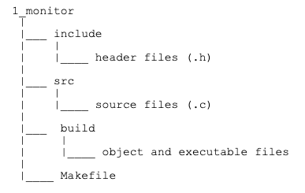
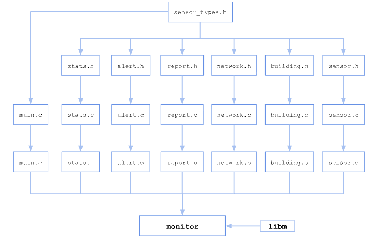
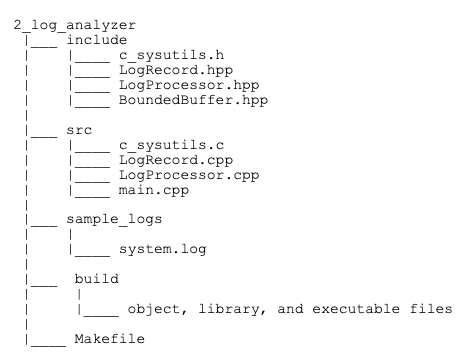

# Programming Assignment 3: Modular Design and Programming in C and C++

This assignment starts with a substantial single-file program — a ~1,000-line Smart Building Environmental Monitoring System, 
using structs, enums, and more than 40 functions — and requires restructuring it into a realistic multi-file C project: 
separate header/implementation files sharing a common struct definition, a Makefile, and conditional compilation with macros.

In the second part, you will build a hybrid C/C++ high-performance Log Parsing and Analytics Engine. 
Real-world systems software frequently integrates C libraries 
(for raw hardware interface, legacy performance modules, or low-level OS bindings) 
with C++ application logic (for abstraction, type safety, and object-oriented structure).
You will write a core memory allocation and binary hashing module in C, 
compile it into both static and dynamic libraries, and 
link them into a modern C++ Engine that processes log streams using templates, operator overloading, and lambda expressions.


# Learning Objectives
By the end of this assignment, you will be able to:

- Identify module boundaries in a large, unfamiliar codebase

- Split a monolithic C file into header (`.h`) and implementation (`.c`) files, including a shared header of struct/enum definitions that multiple modules depend on 

- Automate full build, linking, and execution using a Makefile 

- Use `#ifdef`/`#else`/`#endif` for conditional compilation and write function-like macros

- Combine C and C++ code in the same project

- Build, link, and manage static (.a) and shared/dynamic (.so) libraries

- Structure C++ classes using separate header (.hpp) and implementation (.cpp) files

- Implement core C++ concepts: constructors, destructors, and operator overloading

- Create C++ Template Classes for generic containers

- Manage dynamic memory safely using standard C++ new and delete/delete[] operators

- Perform file stream I/O using C++ std::ifstream and std::ofstream

- Apply modern C++ lambda functions for runtime filtering and aggregation


# Part 1: Modular Design and Programming in C

## Codebase
The file `monitor.c` is about 1,000 lines of C code that simulates a building monitoring system. 
Skim this file using the table-of-contents comment at the top. 
Sketch which functions you think belong together as a 'module' — you don't need to be exact, and there is no single right answer.

The file defines two structs (`Reading`, `Sensor`) and two enums (`SensorType`, `SensorStatus`), and 
organizes more than 40 functions into 17 commented sections — 
sensor data generation, statistics, alerting, reporting, network-wide aggregation, 
correlation analysis, and a `main` that runs a full simulation and prints an extensive report.

Compile and run it to see what "done" looks like:
```bash
gcc -Wall -Wextra -Werror -o monitor monitor.c -lm
./monitor
```
It runs deterministically (fixed random seed) and produces more than 200 lines of report output — 
statistics, alerts, trends, correlations, a floor-by-floor breakdown, maintenance recommendations, and 
a CSV export — all from simulated sensor data, no external input needed.

## Module Creation and Implementation

A suggested module organization is listed below. 

- `sensor_types.h`: Shared struct/enum definitions
   No .c file, just types `Reading`, `Sensor`, `SensorType`, `SensorStatus`

- `sensor.c` (`.h`): Generating simulated readings, initSensor, simulateReadingValue, generateReadingForSensor

- `stats.c` (`.h`): Numeric computations
    computeMin/Max/Average/StdDev, computeCorrelation

- `alert.c` (`.h`): Threshold checking and status
    isAlertReading, classifySensorStatus, recommendMaintenance

- `report.c` (`.h`): All printing/logging/export
    printSensorReport, exportAllSensorCSV

- `network.c` (`.h`): Cross sensor aggregation, sorting, comparisons
    sortSensorByAlertCount, printFloorBreakdown, printTrendReport

- `building.c` (`.h`): The simulation driver
    setupBuilding, 
    runSimulationRounds

- `main.c`: Orchestrate only (`main`)


Notice `sensor_types.h` has no matching `.c` file — it's only declarations, because `Sensor` and `Reading` are types, not behavior. Every other module needs this header, because they all receive `Sensor` pointers as parameters. The shared type definition has to live somewhere every module can reach, but that doesn't belong to any one module's `.c` file."

The structured project must have the file hierarchy as shown below:




Here is an example of two modules stats and alert and how to split them from the original codebase:

Let us create `sensor_types.h` a header that is shared among many modules:
```c
#ifndef SENSOR_TYPES_H
#define SENSOR_TYPES_H
#define MAX_HISTORY 60
#define SIM_ROUNDS 3
#define READINGS_PER_ROUND 12
#define RANDOM_SEED 42

typedef enum {
   SENSOR_TEMPERATURE,
   SENSOR_HUMIDITY,
   SENSOR_PRESSURE,
   SENSOR_CO2,
   SENSOR_LIGHT
} SensorType;

typedef enum {
   STATUS_OK,
   STATUS_WARNING,
   STATUS_CRITICAL
} SensorStatus;

typedef struct {
   double value;
   int timestampSec;
} Reading;

typedef struct {
   char label[24];
   SensorType type;
   double minThreshold;
   double maxThreshold;
   Reading history[MAX_HISTORY];
   int historyCount;
} Sensor;

#endif /* SENSOR_TYPES_H */
```

Let us create the header and implementation files for the `stats` module:
```c
#ifndef STATS_H
#define STATS_H
#include "sensor_types.h"
double computeMin(const Sensor *s);
double computeMax(const Sensor *s);
double computeAverage(const Sensor *s);
double computeStdDev(const Sensor *s, double average);
void computeSensorStats(const Sensor *s, double *minOut, double *maxOut,
                        double *avgOut, double *stdDevOut);
#endif /* STATS_H */
```

Here are two function implementations in `stats.c`:
```c
#include "stats.h"

double computeAverage(const Sensor *s) {
   double sum = 0.0;
   int i;
   if (s->historyCount == 0) {
       return 0.0;
   }
   for (i = 0; i < s->historyCount; i++) {
       sum += s->history[i].value;
   }
   return sum / s->historyCount;
}

void computeSensorStats(const Sensor *s, double *minOut, double *maxOut,
                        double *avgOut, double *stdDevOut) {
   *minOut = computeMin(s);
   *maxOut = computeMax(s);
   *avgOut = computeAverage(s);
   *stdDevOut = computeStdDev(s, *avgOut);
}
```

Complete the implementation file `stats.c` with the definitions of the remaining functions.

Now `alert.h`, which depends on `sensor_types.h` for `Sensor` and will depend on `stats.h` internally:

```c
#ifndef ALERT_H
#define ALERT_H
#include "sensor_types.h"

int isAlertReading(const Sensor *s, double value);
int countAlerts(const Sensor *s);
SensorStatus classifySensorStatus(const Sensor *s);
const char *recommendMaintenance(const Sensor *s);

#endif /* ALERT_H */
```

and `alert.c`

```c
#include "alert.h"
#include "stats.h"
int isAlertReading(const Sensor *s, double value) {
   return (value < s->minThreshold || value > s->maxThreshold);
}
int countAlerts(const Sensor *s) {
   int i;
   int count = 0;
   for (i = 0; i < s->historyCount; i++) {
       if (isAlertReading(s, s->history[i].value)) {
           count++;
       }
   }
   return count;
}
SensorStatus classifySensorStatus(const Sensor *s) {
   int alerts = countAlerts(s);
   if (s->historyCount == 0) { return STATUS_OK; }
   if (alerts > s->historyCount / 3) { return STATUS_CRITICAL; }
   if (alerts > 0) { return STATUS_WARNING; }
   return STATUS_OK;
}
const char *recommendMaintenance(const Sensor *s) {
   SensorStatus status = classifySensorStatus(s);
   double avg = computeAverage(s);
   double stdDev = computeStdDev(s, avg);
   if (status == STATUS_CRITICAL) { 
       return "Immediate inspection recommended"; }
   if (status == STATUS_WARNING && stdDev > 5.0) { 
       return "Monitor closely; readings are volatile"; }
   if (status == STATUS_WARNING) { return "Schedule routine check"; }
   return "No action needed";
}
```

Complete the header and implementation files for all the other remaining modules.

## Makefile
Write the Makefile to build the executable monitor with the appropriate dependencies as shown in the attached image




`-lm`: the original file used `sin`, `cos`, `fabs`, and `sqrt` from `<math.h>` — 
on many systems, linking the math library requires explicitly adding `-lm` at the link step.

```bash
make clean
make
run_tests.sh monitor ref_out.txt
```
Checkpoint: the script should display a score of 100% if your restructured code works as the original monitor

## Conditional Compilation and Macros

Create `config.h` to define simulation constants and conditional debugging message printing:
```c
#ifndef CONFIG_H
#define CONFIG_H
#include <stdio.h>

#define SIM_ROUNDS 3
#define READINGS_PER_ROUND 12
#define RANDOM_SEED 42

#ifdef DEBUG
#define LOG_DEBUG(fmt, ...) printf("[DEBUG] " fmt "\n", ##__VA_ARGS__)
#else
#define LOG_DEBUG(fmt, ...)
#endif

#endif /* CONFIG_H */
```

Add one `LOG_DEBUG` call into `sensor.c`'s reading-generation loop:

```c
#include "config.h"
/* ... inside generateReadingsForSensor's loop, after computing a value: */
LOG_DEBUG("%s: generated reading %d: %.2f", s->label, s->historyCount,
         s->history[s->historyCount].value);
```

Add a Makefile target to set the `DEBUG` macro:
```makefile
debug: CFLAGS += -DDEBUG
debug: clean $(TARGET)
```

Run both ways:

```bash
make clean && make    # no [DEBUG] lines
```

```bash
make debug            # recompiles everything with -DDEBUG
```

# Part 2: Hybrid C & C++ Systems Application

In this part, you will write a core memory allocation and binary hashing module in C, 
compile it into both static and dynamic libraries, and 
link them into a modern C++ Engine that processes log streams using templates, operator overloading, and lambda expressions.

## System Architecture
This part consists of three distinct components:

- Low-level engine in C: `c_sysutils.h`, `c_sysutils.c`, `libsyslogc.a`, and `libsyslogc.so`
Provides C-style memory block allocations, custom string hash functions, and raw byte buffer validation.

- Analytics & Buffer Engine in C++: `LogRecord.hpp`, `LogRecord.cpp`, `LogProcessor.hpp`, `LogProcessor.cpp`, and `BoundedBuffer.hpp`
Provides generic Template Buffer Class, LogRecord representation, File Stream I/O, Operator Overloading, and Lambda Filtering

- Main driver and build system in C++: `main.cpp`, `Makefile`, and executable file `log_analyzer`
Loads files, interfaces with C libraries, runs analytics, and writes report output


## Project Structure
This part must be structured as shown below:


         

## The C Subsystem
The C module consists of `c_sysutils.h` and `c_sysutils.c`. 
The module contains the following functions:

`uint32_t compute_hash_c(const char* data, size_t length)`: 
Computes a fast non-cryptographic hash (FNV-1 algorithm) of raw strings. 
(`uint32_t` is an unsigned integer on 32 bits available in the header `<stdint.h>`)

(Pseudo code of the FNV-1 algorithm)
```c
uint32_t hash = 0x811C9DC5; // 32-bit offset basis 
uint32_t fnv_prime = 0x01000193; // 32-bit FNV prime 
for each byte b in data { 
   hash = hash ^ b; // XOR bitwise operation
   hash = hash * fnv_prime; 
} 
return hash;
```

`void* c_custom_alloc(size_t bytes)`: Allocates memory using low level c allocation (malloc).

`void c_custom_free(void* ptr)`: Deallocates C-allocated memory blocks (free).

The header file is provided below with extern `“C”` guards to allow for compatibility between using C function names 
without effects from the C++ compiler name mangling 
(`g++` changes the names of the functions to support overloading, `gcc` doesn’t).

```c
#ifndef C_SYSUTILS_H
#define C_SYSUTILS_H
#include <stddef.h>
#include <stdint.h>
#ifdef __cplusplus //macro defined by g++, not gcc
extern "C" {
#endif
// Computes FNV-1 hash over raw data buffer
uint32_t compute_hash_c(const char* data, size_t length);
// Custom memory allocation tracking functions
void* c_custom_alloc(size_t bytes);
void c_custom_free(void* ptr);
#ifdef __cplusplus
}
#endif
#endif
```

## The C++ Template Class BoundedBuffer<T>

You will construct a generic dynamic array container `BoundedBuffer` implemented in `BoundedBuffer.hpp` and containing the following components:

- Dynamic Memory: Must manually manage an internal dynamic array of type `T*` using `new[]` and `delete[]`. **Do NOT use `std::vector`**.

- Constructors & Destructors:
. Default constructor: Initial capacity of 10 elements.
. Parameterized constructor: `BoundedBuffer(size_t capacity)`.
. Destructor: Automatically releases dynamic memory allocated by `new[]`.

- Member Functions: `push(const T& item)`, `size()`, `capacity()`, and `clear()`.

## LogRecord Class & Operator Overloading

Construct a class named `LogRecord` in `LogRecord.hpp` and `LogRecord.cpp`.

- Data members: `timestamp` (`string`), `log_level` (`string`)(possible values: INFO, WARN, ERROR), `message` (`string`), and `hash_code`(`uint32_t`).

- Operator overloading:

1. Overload stream insertion operator for formatted output of `LogRecord` objects (`timestamp` between `[ ]`, `log_level` between [ ], Label “`Hash:`” before the hex value of `hash-code`, and label “` | Message: `” followed by `message`).

`std::ostream& operator<<(std::ostream& os, const LogRecord& record)`

2. Overload comparison operator to evaluate log equality based on hash code and message text.

`bool operator==(const LogRecord& other) const` 

3. Overload the addition operator to return a new log record with modified message contents 
 (`extra_info` concatenated to this `LogRecord` message and a space in between) and a new `hash_code`.

`LogRecord operator+(const std::string& extra_info) const`

## File Stream I/O & Lambda Expressions

In `LogProcessor.hpp` / `LogProcessor.cpp`, create three static functions

- `bool parse_file(const string& filepath, BoundedBuffer<LogRecord>& buffer)`

Opens an `ifstream` from `filepath`, parses the file line by line using `getline()`, 
computes each line’s hash code using the C library function (`computer_hash_c`), and 
populates `buffer` (see the sample file `sample_logs/system.log` for the format)

- `bool write_file(const string& filepath, const BoundedBuffer<LogRecord>& buffer)`

Opens an `ofstream` to `filepath` and writes all the log records from `buffer` to the `ofstream`.

- 
```c 
void filter_logs(const BoundedBuffer<LogRecord>& src,
                    BoundedBuffer<LogRecord>& dest, 
                    std::function<bool(const LogRecord&)> func)
```
Iterates through the log records in `src` and adds to `dest` only the logs for which the lambda `func` returns true.
 
## Main Program
In `main.cpp`, implement the following functionality:

1. Create an empty `buffer` of type `BoundedBuffer` with capacity 20

2. Parse the file `sample_logs/system.log` to `buffer` using the function `parse_file` from the class `LogProcessor`
and display the number of logs parsed from the file.

3. Filter ERROR level log records by invoking the function `filter_logs` from the class `LogProcessor`
 with the arguments: `buffer`, a new destination buffer, and a lambda expression to select logs with `log_level` equal to `ERROR`.

Display the number of logs filtered and write the filtered logs to the file `error_summary.log` 
using the function `write_file` from the class `LogProcessor`.

4. Annotate the first error filtered log with the string `[ANNOTATED_BY_SYSTEM]` using the overloaded operator `+`. 
Display the annotated log record to `stdout`.

5. Filter log records containing specific user-defined keywords (example: string `memory`) and display  the number of logs filtered.

6. Filter log records whose hash code matches a target hash modulo value (example: even hash codes) and display the number of logs filtered.

## Build Automation using a Makefile
Your Makefile must compile both C and C++ components and build both static and shared library options. It must contain the following explicit variables and targets:

```makefile
CC       = gcc
CXX      = g++
CFLAGS   = -Wall -Wextra -Werror -g -fPIC -c
CXXFLAGS = -Wall -Wextra -Werror -g
```
    
Targets to fulfill:

- `static_lib`:  Compiles `c_sysutils.c` into `libsyslogc.a` using `ar rcs`
- `dynamic_lib`: Compiles `c_sysutils.c` into `libsyslogc.so` using `gcc -shared`
- `build_static`: Links main C++ application with `libsyslogc.a`
- `build_dynamic`: Links main C++ application with `libsyslogc.so`
- `clean`: Removes all `.o`, `.a`, `.so`, and executable binaries


## Testing and Submission
To test your code,

1. Build the executable (`log_analyzer`)using the static library and run it using the sequence of commands below: 

```bash
make clean
make build_static
./build/log_analyzer
```

2. Build the executable using the dynamic library and run it using the sequence of commands below: 

```bash
make clean 
make build_dynamic
export LD_LIBRARY_PATH=./build:$LD_LIBRARY_PATH
./build/log_analyzer
```

In both cases, the program should have the following outputs (`stdout` and the file `error_summary.log`)

`stdout` (ref_out.txt):
Parsed 5 log records into BoundedBuffer.

[Filter 1] Found 2 ERROR records.

[Operator+ Demo] Modified Log Record:
  [2026-10-08T10:02:30] [ERROR] Hash: 0xb1b8363 | Message: Segfault detected: illegal memory read. [ANNOTATED_BY_SYSTEM]

[Filter 2] Found 2 records with keyword 'memory'.
[Filter 3] Found 2 records matching hash modulo rule.


`error_summary.log` (ref_log.out):
[2026-10-08T10:02:30] [ERROR] Hash: 0xbca56c0a | Message: Segfault detected: illegal memory read.
[2026-10-08T10:03:00] [ERROR] Hash: 0xd13a23fb | Message: Failed to acquire lock on memory buffer.


The script `run_tests.sh` compares your program outputs to the reference files and calculates a score for you. 
To test the executable `log_analyzer`, use the command:
```bash
runTests log_analyzer ref_out.txt ref_log.txt error_summary.log
```

## Submission
Submit the following files to Github and Gradecsope:

- Part 1 (1_monitor with the required folder organization): `sensor_types.h`, `alert.h`, `alert.c`, `building.h`, `building.c`, 
`config.h`, `network.h`, `network.c`, `report.h`, `report.c`, `sensor.h`, `sensor.c`, `stats.h`, `stats.c`, and `Makefile`

- Part 2 (2_log_analyzer with the required folder structure): `c_sysutils.h`, `c_sysutils.c`, `LogRecord.hpp`, `LogRecord.cpp`,
 `LogProcessor.hpp`, `LogProcessor.cpp`, `BoundedBuffer.hpp`, `main.cpp`, and `Makefile`
